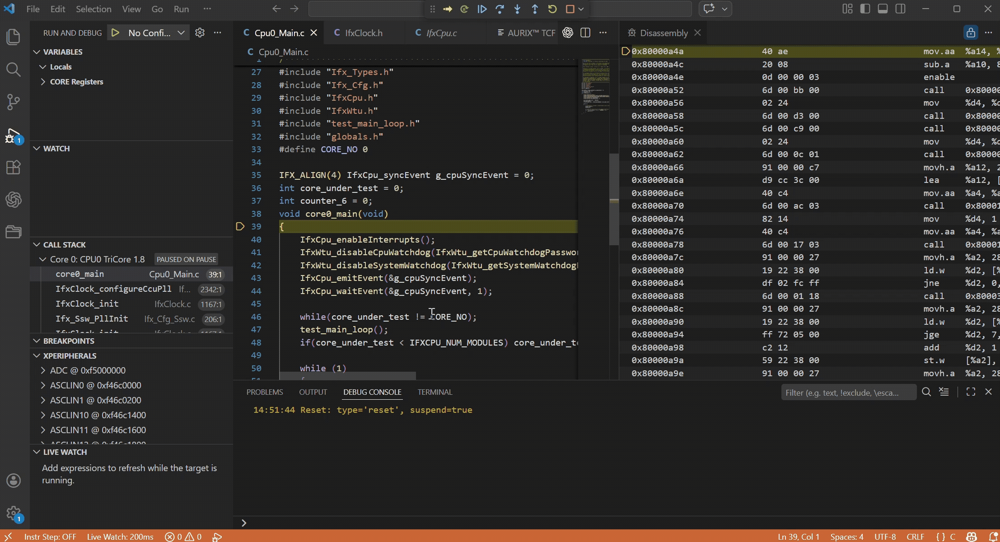
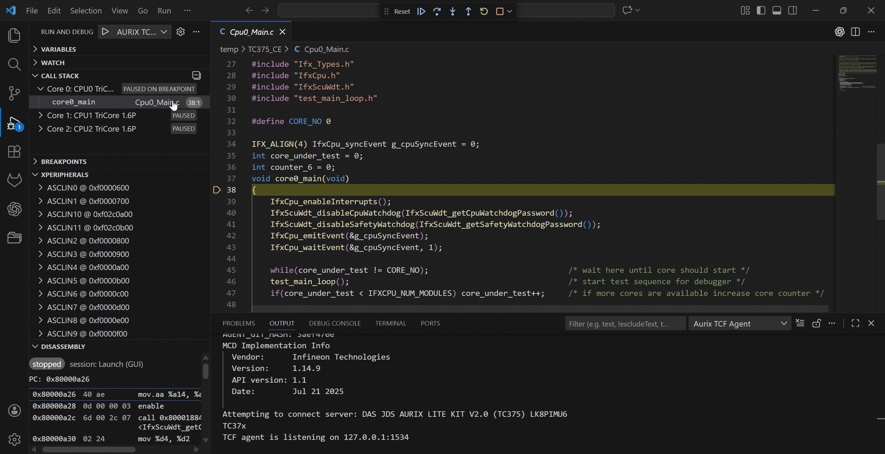
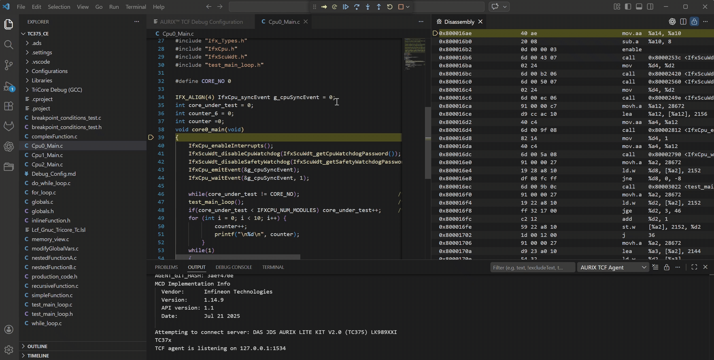
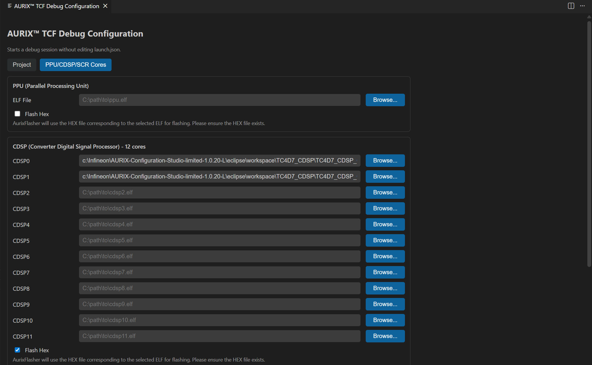

# AURIX&trade; TCF Debugger for VS Code

> **Disclaimer:** This is a personal project, built and maintained by one developer in my own time. It is not an official Infineon product and has nothing to do with Infineon Technologies AG. It comes with no warranty and no promise of support or future updates. Use it at your own risk.

This extension brings the TCF Debugger from [AURIX&trade; Configuration Studio](https://www.infineon.com/design-resources/platforms/aurix-software-tools/aurix-tools/aurix-configuration-studio) to VS Code. It talks to the TCF agent; the VS Code frontend (the debug adapter, UI, and views) is implemented here. AURIX Flasher is bundled for optional pre-debug flashing and as a startup dependency of the TCF agent.

VS Code extension for debugging Infineon AURIX&trade; devices. It supports all AURIX&trade; TC2x, TC3x, and TC4x microcontrollers, including their TriCore, PPU, and CDSP cores.

## Features

- Multi-core debugging
- Line breakpoints and instruction/address breakpoints
- Step in/out, step over, continue/pause, restart, terminate
- Peripheral view (read and write SVD registers)
- Reset and halt at first breakpoint
- Call stack and variables
- Live watch of global variable
- Disassembly view
- Instruction stepping mode 
- Memory Inspector (read and write memeory)
- Launch configuration with AURIX&trade; device detect button
- Debug the PPU and CDSP cores
- Optional pre-debug ELF flashing, including PPU/CDSP HEX files

## Requirements

- Visual Studio Code 1.79.0 or higher
- DAS 8.3.0.1
- Peripheral Inspector extension (installed automatically as a dependency)
- Memory Inspector extension (installed automatically as a dependency)

## Backend binaries (`bin/`)

The backend tools live under `bin/` and are bundled with this repository:

- `aurix-debugger.exe` — the TCF agent
- `aurixflasher/` — AURIX Flasher and its supporting files, required by the TCF agent at startup
- `lsmcdd.exe`, `mcdxdas.dll` — DAS components
- `svd/` — SVD files for the supported devices

Keep the complete `bin/aurixflasher/` directory beside `bin/aurix-debugger.exe` when packaging or deploying the extension, even for debug-only sessions. The extension starts the agent with its containing directory as the working directory.

These tools come from [AURIX&trade; Configuration Studio](https://www.infineon.com/design-resources/platforms/aurix-software-tools/aurix-tools/aurix-configuration-studio) and are not covered by this project's MIT license. Their applicable licenses must be checked separately; the notices under `bin/aurixflasher/license/` do not establish licensing for the debugger, DAS components or SVD files.

### Flashing support

Select **Enable flashing** in the configuration panel, or set `enableFlashing: true`, to flash `program` with the bundled AURIX Flasher before starting the debug session. This option defaults to `false`; leave it disabled to debug firmware already on the target.

With **Enable flashing** selected, PPU/CDSP **Flash Hex** (`ppuFlashHex` / `cdspFlashHex`) adds the corresponding `.hex` files beside the configured ELFs to the same flasher invocation. Generate these HEX files before debugging; the extension does not convert them. Missing files stop launch with an explicit error. ELF files continue to provide debug symbols.

The flasher resolves `targetDevice` through `lsmcdd.exe` and runs with `-gui off -elf <program> [-hex <file> ...] -start off -ver on -id <deviceId>`. If no device is configured, exactly one connected device is required. Output is shown in **AURIX Flasher**. **As in the original workflow, a failed flash retries once with `-erase all`, which may erase existing target flash contents.** If the retry fails, debugging does not start.

Before flashing on Restart, the extension stops its previously owned agent to release the DAS connection. Externally managed agents are not stopped; release their target connection before using integrated flashing. The updated backend binaries and restored flashing workflow still require hardware validation.

With `autoStartAgent=true`, each debug session (including VS Code Restart) starts a fresh agent after the previous owned process and port have closed. This prevents stale launch arguments and breakpoints from carrying into a new session. Externally managed agents (`autoStartAgent=false`) are not restarted by this policy.

## Build

```bash
npm install
npm run package
```

`npm run package` compiles the TypeScript sources, copies the static assets, and produces `vscode-aurix-tcf-debug.vsix` in the project root.

## Testing

Run `npm run test:unit` for offline checks. ACS-derived hardware regression tests require an explicit, calibrated board profile and never flash automatically. See [TESTING.md](TESTING.md) for setup, commands and coverage boundaries, and [ACS_TEST_MAP.md](ACS_TEST_MAP.md) for case traceability.

## Installation

### Install from VSIX

1. Build the project (see above) or download the `.vsix` from [Releases](https://github.com/ZeZhan/vscode-aurix-tcf-debugger/releases)
2. Open the Extensions view by selecting the Extensions icon in the Activity Bar, or use the (`Ctrl+Shift+X`) keyboard shortcut.
3. Click `...` and choose "Install from VSIX..."
4. Select the `.vsix` file
5. Open Command Palette and run `Developer: Reload Window`

## Usage

### Debug configuration (UI)

1. Open Command Palette and run `AURIX™ TCF: Open Debug Configuration`
2. Fill in the fields and save the configuration
3. Click `Debug` to start debugging


### Or create launch.json manually

Create `.vscode/launch.json`:

```json
{
  "version": "0.2.0",
  "configurations": [
    {
      "type": "aurix-tcf",
      "request": "launch",
      "name": "AURIX TCF Debug",
      "host": "127.0.0.1",
      "port": 1534,
      "autoStartAgent": true,
      "program": "${workspaceFolder}\\temp\\TC375_CE\\TriCore Debug (GCC)\\TC375_CE.elf",
      "targetDevice": "DAS JDS AURIX LITE KIT V2.0 (TC375) LK8PIMU6",
      "entryFunction": "core0_main",
      "svdFile": "",
      "workspace": "${workspaceFolder}\\temp\\TC375_CE",
    }
  ]
}
```

### Start debugging

We suggest start debugging with `AURIX™ TCF: Open Debug Configuration`


### Multicore breakpoint stops

Breakpoint notifications advertise all cores stopped only after fresh native state queries confirm every execution context is suspended. The debugger preserves the hit core as the focus and does not force other cores to halt during this verification. If confirmation fails, the Debug Console reports the problem and the notification does not claim an all-core stop. Pending verification is invalidated on resume, reset or disconnect. See [TESTING.md](TESTING.md) for the three-core hardware regression results.

### Stopped core and source focus

Breakpoint and step stops select the corresponding core/frame in CALL STACK. Passive sibling-core pause notifications preserve that selection. When a frame is selected, its recorded source location is revealed alongside disassembly without taking keyboard focus; stale asynchronous source requests cannot override a newer selection. Source lookup uses the selected thread/frame, not the filename, so shared source files do not determine core selection. Manually switching source editor tabs does not switch debug cores.

### Watch global variables

Variables and expressions can be watched in the Run and Debug view's **WATCH** section.


### Live Watch View

The Live Watch view periodically refreshes selected global variables. Use the view's Settings button to configure the refresh interval (the minimum enforced value is 200 ms).

Once configured, the active interval appears in the view header (highlighted in orange). Resume the target to run the cores and observe the selected global variables update automatically.



### Peripheral View

This Peripheral View depends on the extension `mcu-debug.peripheral-viewer`. A SVD file is needed to enable this view and to keep it in sync with the target.



### Memory Inspector

The extension depends on `eclipse-cdt.memory-inspector`. Use the Command Palette and run
`Memory Inspector: Show Memory Inspector` to open the view, then enter an
address or expression once the target is paused.


### Disassembly View & Instruction Stepping Mode

The extension does not automatically open Disassembly or split, lock or resize editor groups when debugging starts. To open it manually while paused, right-click a source editor and choose **Open Disassembly View**. The view stays synchronized with the currently selected frame. The toolbar includes an `Enable Instruction Stepping` button, which allows stepping through the program's disassembly instructions.

The former `aurix-tcf.autoOpenDisassemblyView`, `aurix-tcf.autoLockDisassemblyView` and `aurix-tcf.autoEvenEditorWidths` settings have been removed; existing values no longer have any effect. CALL STACK selection and source reveal still follow the selected core/frame.

In instruction mode, Step Into enters a call and Step Over executes over it. Unavailable disassembly entries are marked invalid with `<not decoded>` rather than fabricated instructions or opcode bytes. See [TESTING.md](TESTING.md) for hardware evidence and the known instruction Step Over user-breakpoint stop-reason limitation.



**Note:** If the `Enable Instruction Stepping` icon is grayed out, it indicates that instruction stepping is already enabled. To switch back to source code stepping, click the icon `Disable Instruction Stepping` again to disable instruction stepping.


Instruction breakpoints can be set in the same way as in the source code.

If the disassembly view is closed, use the Command Palette and run `Open Disassembly View` to open the view

### PPU / CDSP Cores

In addition to the TriCore cores, the debugger supports the cores: **PPU** and **CDSP**. Open `AURIX™ TCF: Open Debug Configuration` and switch to the **PPU/CDSP/SCR Cores** tab to assign an ELF file to each core:

- **PPU** — a single ELF file
- **CDSP** — up to 12 ELF files (CDSP0 – CDSP11)

The assigned ELF files provide the debug symbols used for source-level debugging on the corresponding core.



#### Flash Hex option

PPU/CDSP **Flash Hex** controls are disabled while integrated flashing is unavailable. Configure the ELF files for debug symbols and program the firmware externally.


## License

The code in this repository is released under the MIT License - see [`LICENSE`](LICENSE).

The prebuilt tools under `bin/` are not covered by that license. They come from AURIX&trade; Configuration Studio and keep their own licenses - see [`THIRD_PARTY_NOTICES.md`](THIRD_PARTY_NOTICES.md).
